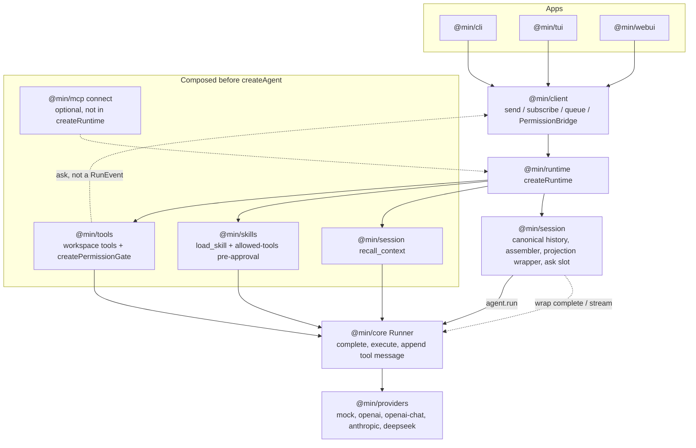
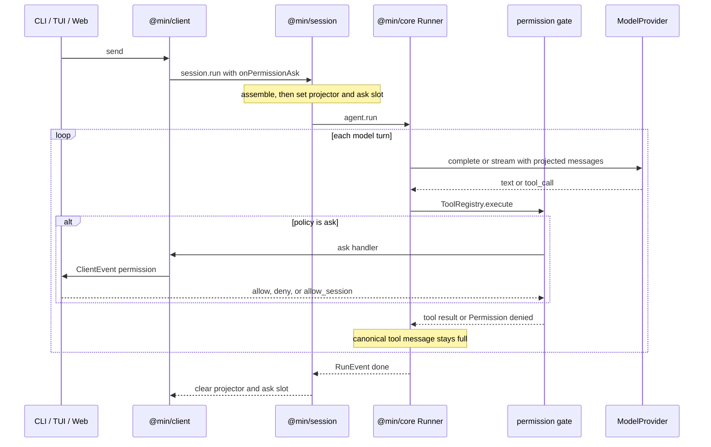

# min

A minimal, extensible TypeScript **agent harness**. Core packages, `@min/client` facade, CLI / Ink TUI / Web (shadcn B/S) — MVP slice is runnable end-to-end.

## Why min

- **Small core**: one agent loop, tools, and a provider-agnostic message model.
- **Wide edge**: Skills, MCP, and workspace tools are composed by the host and passed into `createAgent`. The runner does not own a plugin bus.
- **Dual protocols**: Anthropic Messages and OpenAI Responses adapters — vendor formats never leak into the loop.

## Monorepo

```text
packages/
  core/      @min/core     loop (Runner, tools, ModelProvider contract)
  providers/ @min/providers built-in providers + registerProvider extension
  mcp/       @min/mcp      MCP client extension
  skills/    @min/skills   Agent Skills (SKILL.md) + allowed-tools gate
  tools/     @min/tools    sandboxed read/write/glob/bash
  session/   @min/session  conversation sessions + context budget + input queue
  runtime/   @min/runtime  shared composition layer for CLI / TUI
  client/    @min/client   UI facade: send / subscribe / queue / permission
apps/
  cli/       @min/cli      one-shot + REPL (via @min/client)
  tui/       @min/tui      Ink terminal UI (via @min/client)
  webui/     @min/webui    B/S Web UI — Node server + Vite/React/shadcn
examples/
  basic/                   Offline mock example (+ optional live providers)
  input-queue-scenarios/   supplement / redirect queue demos
```

## Architecture

`@min/core` is the model round-trip and the tool loop. Permissions, skills, workspace policy, and the projected model view are composed by the host and never enter the runner as concepts.



One user turn:



`RunEvent` is only `turn_start`, `text_delta`, `tool_call`, `tool_result`, `turn_end`, `done`, and `error`. A permission prompt is a client event raised by the gate.

## Quick start

```bash
pnpm install
pnpm build
pnpm test
pnpm example          # mock provider, no API key needed
pnpm min -- "list files here"   # CLI with workspace tools (mock if no key)
pnpm min -- -i                  # interactive REPL
pnpm min-tui                    # terminal chat UI
pnpm min-web                    # Web UI (API :43127 + Vite :43128)

# Global `min` on PATH (requires `pnpm setup` once so PNPM_HOME is exported)
pnpm link:cli
min --help
```

Live providers (optional):

```bash
PROVIDER=anthropic ANTHROPIC_API_KEY=... pnpm example
PROVIDER=openai OPENAI_API_KEY=... pnpm example
PROVIDER=deepseek DEEPSEEK_API_KEY=... pnpm example
DEEPSEEK_API_KEY=... pnpm min -- "summarize README.md"
```

DeepSeek defaults to the OpenAI-compatible **Responses** API (`deepseekProvider` in `@min/providers`). Set `DEEPSEEK_API=chat` to use Chat Completions instead.

Built-in ids: `mock`, `openai`, `openai-chat`, `anthropic`, `deepseek`. Add another without editing `@min/core`:

```ts
import { registerProvider } from "@min/providers";
import type { ModelProvider } from "@min/core";

const groq: ModelProvider = { id: "groq", async complete(req) { /* ... */ return { message, stopReason: "end" }; } };
registerProvider("groq", () => groq);
```

`MIN_PROVIDER_MODULE` (comma-separated package or file path) is loaded by the CLI, TUI, and Web before provider lookup. The module should call `registerProvider`. Passing a `ModelProvider` straight into `createAgent` / `createRuntime` also works and skips the registry.

### Workspace tools (`@min/tools`)

Registered by the CLI (unless `--no-tools`): `read_file`, `write_file`, `glob`, `bash`, all scoped to `--cwd`.

### Permissions (fluency-first)

| Surface | Default | Notes |
|---------|---------|--------|
| read / glob | allow | Inside primary + session roots |
| write_file | allow | `--ask-write` to confirm |
| bash | ask | Small allowlist (`git`, `ls`, `pnpm`, …) auto-passes |
| path outside roots | ask | Approving adds a **tight session root** (`dirname` / dir itself) |
| other tools | ask | `load_skill` and `recall_context` are trusted. MCP and other host tools ask |

- Interactive ask: `[y]es` once, `[n]o`, `[a]lways` remembers the pattern (bash prefix, one path, one tool name, or the approved root) in `<cwd>/.min/permissions.json`
- A remembered bash prefix matches later simple commands with the same first token. Commands with shell syntax (`&&`, `|`, redirects, quotes) are remembered exactly, and a prefix does not cover them
- `-y` / `--yes` — auto-approve tool prompts **once** (not root expansion; needs `--allow-root-grant`)
- `--auto` — full-auto for this process: bash allowed, asks answered as `allow_session`, sandbox root grants approved (`MIN_AUTO=1` same). Those grants are not written to the rules file. Still scoped by the sandbox model; not a total security bypass.
- Seed roots: `--add-root <dir>` (repeatable)
- One-shot without TTY: `ask` → deny unless flags allow
- Denied tools return `tool_result` with `isError` — the run continues
- Policy (`allow` / `deny` / `ask`, `grantRoot`) lives in `@min/tools` and is applied by wrapping `execute` before `createAgent`. The handler receives the real tool-call id, turn, and canonical messages. Core never sees a permission decision.

### Sessions and context budget (`@min/session`)

- Canonical history is kept in a `Session` (optionally under `<cwd>/.min/sessions`).
- Model view is built by a **pluggable `ContextAssembler`** (SessionExtension). Strategies are swappable for eval:

| Strategy | How to enable | Behavior |
|----------|---------------|----------|
| **`hybrid`** (default w/ tools) | default when tools on | Sticky head + middle tool-offload + **intra-turn aging** (fold older `tool_result`s inside the active turn, keep last N verbatim) + middle collapse; + `recall_context`. |
| **`trim`** (default w/o tools) | `--no-tools` / `contextStrategy: "trim"` | Drop oldest user-turns under budget. Eval baseline. |
| **`sticky-trim`** | `contextStrategy: "sticky-trim"` | Freeze leading turns; only trim after them (cache-friendlier). |
| **`tool-offload`** | `contextStrategy: "tool-offload"` | Fold large `tool_result`s into stash (protect last turn); + `recall_context`. |
| **`hmt`** | `contextStrategy: "hmt"` | Head/middle/tail: fold middle only; + stash/`recall_context`. |

On-demand (not a continuous strategy): `session.compact()` / Client `compact()` / REPL `/compact` rewrites stored history to `[LLM summary] + recent turns`.

**Dual history + mid-loop projection**

- Canonical session / Runner history stays full (including fat tool bodies).
- Before every model `complete` inside a tool loop, Session re-runs the assembler inside a `ModelProvider` wrapper and sends only the projected view. Canonical history stays on the Runner.
- That closes the gap where a single user-turn coding run never got a second assemble (hybrid used to look idle until the next `session.run`).
- Multi-turn fold/stash/recall check: `pnpm --filter @min/example-hmt-context exec tsx verify-multiturn.mts`

- Stash markers look like `…[hidden:tool_<id> · recall_context]…` when a stash strategy is on.
- Token estimate defaults to ~4 chars/token; inject `budget.estimate` to override.
- CLI: `--context-strategy <id>`, `--session`, `--max-context-tokens`, …
- Env: `MIN_CONTEXT_STRATEGY=trim|hmt|tool-offload|sticky-trim|hybrid`.
- CLI `context-budget-log` prints after every assemble (including mid-loop), not only when trimmed.

Session stays a thin kernel; extend via composition:

| Extension point | Role |
|-----------------|------|
| `SessionStore` | Persist/load snapshots (`Memory` / `Fs` / custom) |
| `ContextAssembler` | Build the model view (default: hybrid w/ tools, trim otherwise) |
| `SessionHooks` | `onBeforeRun` / `onAfterAssemble` / `onAfterRun` / `onBeforeSave` |
| `SessionExtension` | Package assembler + hooks (`defineSessionExtension`) |

Kernel responsibilities only: identity, canonical history, `run`/`compact`/`reset`/`export`, store I/O.
Follow-up **input queue** (`createInputQueue`) lives in `@min/session` only: default `enqueue`, with a 1.5s `dense-latest` window for rapid supplements. Drained **after** each `agent.run` returns — `@min/core` is unchanged.
Everything else plugs in:

```ts
import { createSession, defineSessionExtension, createBudgetAssembler } from "@min/session";

const compact = defineSessionExtension({
  name: "compact-log",
  // Optional: replace the default budget assembler
  // assembler: createBudgetAssembler({ maxContextTokens: 16_000 }),
  hooks: {
    onBeforeRun() { /* audit / metrics */ },
    onAfterAssemble(ctx) {
      // Return a new AssembleResult to override the model view
      return ctx.assemble;
    },
    onAfterRun({ assemble }) {
      if (assemble.trimmed) console.info("context trimmed", assemble.dropped.length);
    },
    onBeforeSave(snapshot) {
      // Transform or redact before persist
      return snapshot;
    },
  },
});

const session = await createSession({
  agent,
  store,
  budget: { maxContextTokens: 16_000 },
  extensions: [compact],
  // assembler: …  // explicit option wins over extension assemblers
});
```

The CLI ships one pack (`cli.context-budget-log`) the same way — observability stays outside the kernel.

## Usage

```ts
import { createAgent, defineTool } from "@min/core";
import { anthropicProvider } from "@min/providers";
import { mcp } from "@min/mcp";
import { skills } from "@min/skills";
import { z } from "zod";

const systemParts = ["You are min."];
const loadedSkills = await skills({
  dirs: ["./skills"],
  appendSystem: (text) => systemParts.push(text),
});
const filesystem = await mcp({
  servers: [{ name: "fs", transport: "stdio", command: "npx", args: ["-y", "@modelcontextprotocol/server-filesystem", "."] }],
}).connect();

const echo = defineTool({
  name: "echo",
  description: "Echo a string",
  inputSchema: z.object({ message: z.string() }),
  async execute({ message }) {
    return { content: message };
  },
});

const agent = await createAgent({
  provider: anthropicProvider({ model: "claude-sonnet-4-5" }),
  tools: [echo, ...loadedSkills.tools, ...filesystem.tools],
  system: () => systemParts.join("\n\n"),
});

const result = await agent.run("Hello");
console.log(result.text);
await filesystem.dispose();
```

### Adding a tool from the host

```ts
import { createAgent, defineTool, type ModelProvider } from "@min/core";
import { z } from "zod";

const ping = defineTool({
  name: "ping",
  description: "Ping",
  inputSchema: z.object({}),
  async execute() {
    return { content: "pong" };
  },
});

export function withLogging(inner: ModelProvider): ModelProvider {
  let turn = 0;
  return {
    id: inner.id,
    async complete(req) {
      turn += 1;
      console.log("turn", turn, "messages", req.messages.length);
      return inner.complete(req);
    },
    stream: inner.stream?.bind(inner),
  };
}
```

### Skills layout

```text
skills/
  greeter/
    SKILL.md    # YAML frontmatter: name + description
```

Follows the [Agent Skills](https://agentskills.io/specification) format. Metadata loads at startup; full body loads via the `load_skill` tool (progressive disclosure).

`allowed-tools` follows the Agent Skills spec: a space-separated list of tools pre-approved to run after the skill loads. Other tools stay available under the normal permission policy. Sandbox root grants are unchanged.

## Design notes

| Layer | Responsibility |
|-------|----------------|
| Internal messages | Single source of truth (`text` / `tool_call` / `tool_result`) |
| `ModelProvider` | Translate to Anthropic Messages or OpenAI Responses. Hosts may wrap it to project messages or observe turns. |
| `Runner` | Tool-use loop: complete, execute tools, append tool results |
| Host composition | Skills, MCP, workspace tools, and permission gates are assembled before `createAgent` |

Phase 2 will add interactive surfaces under `apps/` without changing the harness contract.
